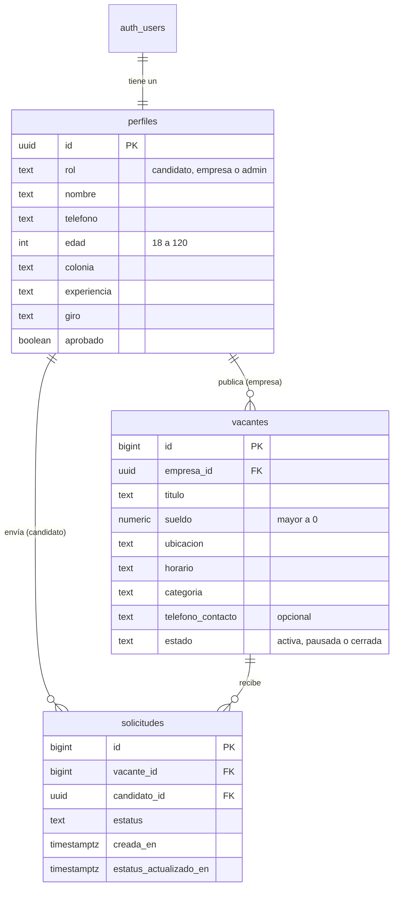
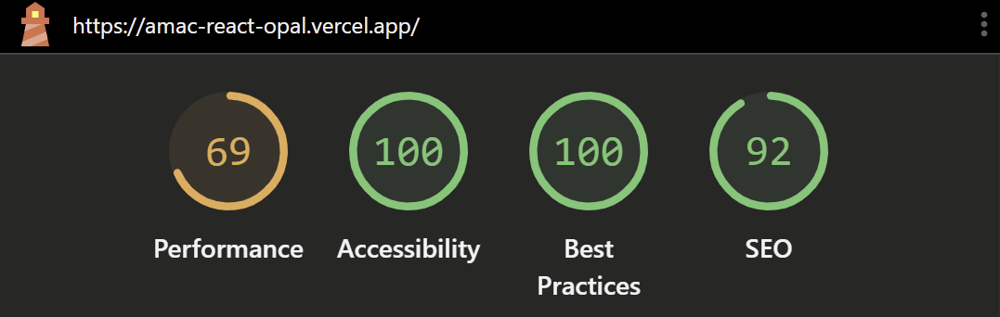

# AMAC: Plataforma de empleo

Proyecto final de Desarrollo de Aplicaciones Web (OT2026-WEB), Entrega 3.

AMAC es una bolsa de trabajo para personas adultas mayores en Nuevo León. En la Entrega 1 hicimos el prototipo en Figma y en la Entrega 2 lo pasamos a HTML y CSS. En esta entrega final se volvió una aplicación real: el frontend está hecho en React, los datos se guardan en una base de datos PostgreSQL en Supabase (con inicio de sesión y seguridad por fila) y la app está publicada en Vercel.

**Aplicación publicada:** https://TU-URL.vercel.app

**Repositorio:** https://github.com/elihuosuna-a11y/amac-react

**Video de la presentación:** ENLACE-AL-VIDEO

**Diapositivas:** ENLACE-A-LAS-DIAPOSITIVAS

## Equipo

| Integrante | Qué hizo |
|---|---|
| Elihu Osuna | Proyecto en Vite, rutas (`App.jsx`), contexto de sesión, rutas protegidas, encabezado y pie, base de datos en Supabase (esquema, políticas RLS y datos de ejemplo), publicación en Vercel y README |
| Gustavo Treviño | Flujo del candidato: listado con búsqueda y filtros, detalle de vacante, postularse, Mis solicitudes con cancelación, y los componentes de tarjeta, botón, estatus y avisos |
| Omar Villareal | Formularios: inicio de sesión, registro de candidato y de empresa, Mi cuenta; flujo de la empresa (Mis vacantes, Publicar vacante, Solicitudes recibidas) y panel de AMAC para aprobar candidatos |

## Cuentas de prueba

| Tipo | Correo | Contraseña |
|---|---|---|
| Candidato aprobado | candidato.aprobado@amac-prueba.com | AmacDemo2026 |
| Candidato sin aprobar | candidato.pendiente@amac-prueba.com | AmacDemo2026 |
| Empresa | empresa.demo@amac-prueba.com | AmacDemo2026 |
| Administrador de AMAC (extra) | admin@amac-prueba.com | AmacDemo2026 |

## Tecnologías

- **React 19 con Vite** para el frontend (una sola página con rutas).
- **React Router** para las rutas y las rutas protegidas por rol.
- **Supabase**: PostgreSQL, inicio de sesión (Auth) y seguridad por fila (RLS).
- **Vercel** para publicar la app con HTTPS; cada `git push` a `main` publica una nueva versión.
- **CSS propio** de la Entrega 2 (sin Bootstrap ni Tailwind), separado en `variables.css`, `base.css`, `layout.css`, `componentes.css` y `app.css`.

## Cómo correrlo en tu computadora

Necesitas Node.js 20 o más reciente (`node -v`).

```bash
git clone https://github.com/elihuosuna-a11y/amac-react.git
cd amac-react
npm install
```

Copia el archivo `.env.example` como `.env.local` y pon los datos de tu proyecto de Supabase (Project Settings → API Keys):

```
VITE_SUPABASE_URL=https://xxxxxxxx.supabase.co
VITE_SUPABASE_PUBLISHABLE_KEY=sb_publishable_xxxxxxxx
```

Después:

```bash
npm run dev
```

y abre http://localhost:5173. El archivo `.env.local` está en `.gitignore` y nunca se sube a GitHub.

Para crear la base de datos desde cero: en Supabase → SQL Editor, corre `supabase/esquema.sql`; luego crea las cuentas de prueba desde la app y corre `supabase/datos-ejemplo.sql` para cargar las vacantes y aprobar al candidato de prueba.

## Cómo está organizado

```
src/
├── main.jsx                 punto de entrada: BrowserRouter + AuthProvider
├── App.jsx                  definición de las rutas
├── lib/supabase.js          cliente de Supabase (solo la publishable key)
├── context/AuthContext.jsx  quién está conectado y con qué rol
├── components/              piezas reutilizables
├── pages/                   una página por ruta
├── utils/                   formato de fechas y sueldos, validaciones
└── styles/                  CSS de la Entrega 2 + lo nuevo de esta entrega
supabase/
├── esquema.sql              tablas, funciones, trigger y políticas RLS
└── datos-ejemplo.sql        vacantes de ejemplo y aprobación del candidato de prueba
```

### Rutas

| Ruta | Página | Quién entra |
|---|---|---|
| `/` | Listado de vacantes | Todos |
| `/vacantes/:id` | Detalle de vacante | Todos |
| `/login` | Iniciar sesión | Todos |
| `/registro` | Registro de candidato | Todos |
| `/registro-empresa` | Registro de empresa | Todos |
| `/conoce-amac` | Conoce a AMAC | Todos |
| `/cuenta` | Mi cuenta y cerrar sesión | Con sesión |
| `/mis-solicitudes` | Mis solicitudes | Candidato |
| `/empresa/vacantes` | Mis vacantes | Empresa |
| `/empresa/publicar` | Publicar vacante | Empresa |
| `/empresa/solicitudes` | Solicitudes recibidas | Empresa |
| `/admin` | Aprobar candidatos | Administrador |

Si alguien sin sesión entra a una ruta protegida, lo manda a `/login`; si entra con otro rol, lo manda al inicio. El archivo `vercel.json` hace que estas rutas funcionen aunque se recargue la página.

### Componentes reutilizables

Las clases que en la Entrega 2 se repetían ahora son componentes:

| Componente | Para qué sirve |
|---|---|
| `Boton` | Botón o enlace con las variantes primario, secundario, peligro y coral |
| `TarjetaVacante` | Tarjeta del listado (recibe la vacante por props) |
| `EtiquetaEstatus` | Estatus con ícono y palabra: Enviada, En revisión, Aceptada, Rechazada, Cancelada, Activa, Pausada, Cerrada |
| `Campo` y `Casilla` | Campos de formulario con etiqueta visible, ayuda y mensaje de error |
| `Aviso` | Mensajes de éxito, error, advertencia e información |
| `Encabezado` y `Pie` | Encabezado con menú según el rol (abajo en celular) y pie de página |
| `RutaProtegida` | Esconde páginas según el rol |
| `TituloPagina`, `SeccionFormulario`, `TarjetaAyuda`, `EnlaceRegresar`, `BotonAyuda`, `Logo`, `Icono`, `Cargando` | Piezas de diseño que se repiten |

`useState` guarda lo que cambia en cada página (búsqueda, filtros, formularios, mensajes) y `useEffect` consulta a Supabase cuando cambian esos valores. El contexto `AuthContext` guarda la sesión y el perfil (rol, nombre, si está aprobado) para que cualquier componente los use con `useAuth()`.

## Base de datos


*(Captura de Supabase → Database → Schema Visualizer.)*



Tres tablas:

- **perfiles**: un perfil por cada usuario de Supabase Auth. Se crea solo al registrarse, con el trigger `crear_perfil()`. Las contraseñas no están aquí: las maneja Supabase Auth.
- **vacantes**: cada vacante pertenece a una empresa.
- **solicitudes**: une a un candidato con una vacante. La restricción `unique (vacante_id, candidato_id)` impide postularse dos veces a la misma vacante.

El SQL completo está en [`supabase/esquema.sql`](supabase/esquema.sql).

### Políticas de seguridad (RLS)

RLS está activado en las tres tablas. Aunque alguien manipule el navegador o use la consola, PostgreSQL solo le entrega o le deja cambiar las filas que estas reglas permiten.

**perfiles**

| Política | Qué hace |
|---|---|
| Cada quien ve su perfil | Un usuario solo puede leer su propio perfil |
| Todos ven los perfiles de empresas | Para mostrar el nombre de la empresa en las vacantes |
| La empresa ve a quien aplicó a sus vacantes | La empresa solo ve los datos de candidatos que se postularon con ella |
| AMAC ve todos los perfiles | El administrador puede revisar a los candidatos para aprobarlos |
| Cada quien edita su perfil | Solo puede cambiar sus datos, y nunca su `rol` ni `aprobado` (se quitaron esos permisos de columna) |

**vacantes**

| Política | Qué hace |
|---|---|
| Ver vacantes activas o las propias | El público solo ve vacantes activas; la empresa también ve las suyas pausadas o cerradas |
| El candidato sigue viendo las vacantes a las que aplicó | Aunque la vacante se pause, en Mis solicitudes se sigue viendo (RF-021) |
| Solo empresas publican, a su nombre | Un candidato no puede publicar y una empresa no puede publicar a nombre de otra |
| La empresa edita sus vacantes | Solo la dueña puede pausar, reactivar o cerrar |

**solicitudes**

| Política | Qué hace |
|---|---|
| Candidato ve las suyas; empresa ve las de sus vacantes | Nadie ve solicitudes ajenas |
| Solo candidatos aprobados se postulan a vacantes activas | Bloquea a candidatos que AMAC no ha aprobado (RF-054), a nombre de otro, con un estatus distinto de "Enviada" o a vacantes pausadas |
| Candidato cancela si no está resuelta | Solo puede pasarla a "Cancelada" si está "Enviada" o "En revisión" (RF-006) |
| Empresa cambia el estatus | Solo a "En revisión", "Aceptada" o "Rechazada", y nunca una cancelada (RF-024) |

Además, de una solicitud solo se puede modificar la columna `estatus`, y el campo `aprobado` solo lo cambia la función `cambiar_aprobacion()`, que revisa que quien la llama sea administrador.

## Requerimientos implementados

| RF | Descripción | Estado |
|---|---|---|
| RF-001 | Listado de vacantes activas desde la base de datos | ✅ completo |
| RF-002, RF-007 | Búsqueda por título o ubicación y filtros por horario y categoría | ✅ completo |
| RF-003 | Detalle de la vacante | ✅ completo |
| RF-051 | Botón "Llamar" solo si la vacante tiene teléfono | ✅ completo |
| RF-011, RF-012, RF-013 | Registro de candidato con términos obligatorios | ✅ completo |
| RF-008, RF-009 | Inicio y cierre de sesión con mensaje de error genérico | ✅ completo |
| RF-004 | Postularse con confirmación, sin poder aplicar dos veces | ✅ completo |
| RF-054 | Solo candidatos aprobados se postulan | ✅ completo |
| RF-005, RF-006 | Mis solicitudes y cancelar con confirmación (no Aceptada ni Rechazada) | ✅ completo |
| RF-015 | Registro de empresa (versión simplificada) | ✅ completo |
| RF-019 | Publicar vacante con validación; teléfono solo si se elige | ✅ completo |
| RF-020, RF-021 | Mis vacantes con número de solicitudes; pausar, reactivar y cerrar | ✅ completo |
| RF-022, RF-024 | Solicitudes recibidas y cambio de estatus | ✅ completo |
| RF-010 | Rutas protegidas por rol y RLS en todas las tablas | ✅ completo |
| RF-054 (extra) | Panel de administrador para aprobar candidatos | ✅ completo |
| RF-024 (extra) | Fecha del último cambio de estatus | ✅ completo |
| RF-014, RF-017 | Editar perfil | ❌ pendiente |
| RF-016 | Logo de empresa con Supabase Storage | ❌ pendiente |
| RF-029 | Recuperar contraseña | 🟡 parcial: se indica llamar a AMAC |
| RF-041 | Vacantes favoritas | ❌ pendiente |
| RF-055 | Proceso de selección por etapas | 🟡 parcial: se muestran pasos generales en el detalle |

## Accesibilidad y diseño responsivo

Se mantuvo lo de la Entrega 2: letra de 18 px o más, botones de al menos 44 px, etiquetas visibles en todos los campos, foco visible al usar el teclado, estatus con ícono y palabra, y menú inferior en celular. En React además:

- Al cambiar de página, el foco pasa al contenido y el título de la pestaña cambia.
- Los errores de los formularios aparecen junto a cada campo y el foco va al primero que hay que corregir.
- Las confirmaciones (postularse, cancelar, cerrar vacante) aparecen en la misma pantalla.

Probado en 320, 768, 1024 y 1440 px.


