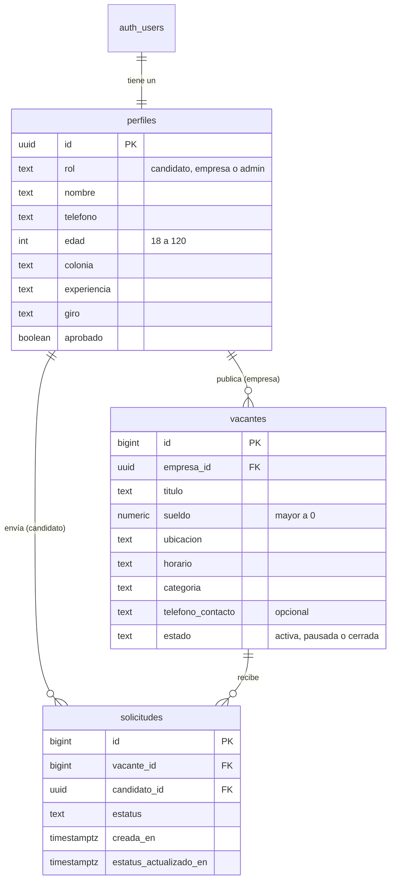

# AMAC - Bolsa de trabajo para adultos mayores

Proyecto final de Desarrollo de Aplicaciones Web (OT2026-WEB), Entrega 3.

AMAC es una bolsa de trabajo pensada para personas adultas mayores de Nuevo León. Empezamos con el prototipo en Figma (Entrega 1), después lo pasamos a HTML y CSS (Entrega 2) y en esta última entrega lo convertimos en una aplicación que ya funciona de verdad. El frontend está hecho en React, la información se guarda en Supabase y la página está publicada en Vercel.

- Aplicación: https://amac-react-opal.vercel.app
- Repositorio: https://github.com/elihuosuna-a11y/amac-react
- Video: ENLACE-AL-VIDEO
- Diapositivas: ENLACE-A-LAS-DIAPOSITIVAS

## Equipo

| Integrante | Qué hizo |
|---|---|
| Elihu Osuna | Armó el proyecto con Vite, las rutas, el manejo de la sesión, las rutas protegidas, el encabezado y el pie. También hizo la base de datos en Supabase, la publicación en Vercel y este README. |
| Gustavo Treviño | Hizo todo lo del candidato: el listado con búsqueda y filtros, el detalle de cada vacante, postularse y la página de Mis solicitudes. También los componentes de tarjeta, botón, estatus y avisos. |
| Omar Villareal | Hizo los formularios (iniciar sesión, registro de candidato y de empresa, Mi cuenta), todo lo de la empresa (Mis vacantes, Publicar vacante y Solicitudes recibidas) y el panel donde AMAC aprueba candidatos. |

## Cuentas para probar

Todas usan la contraseña `AmacDemo2026`.

| Quién | Correo |
|---|---|
| María Guadalupe Treviño, candidata ya aprobada | maria.trevino@correo-prueba.mx |
| José Luis Garza, candidato que AMAC todavía no aprueba | jose.garza@correo-prueba.mx |
| Servicios Integrales del Norte, empresa | rh@serviciosdelnorte.mx |
| Coordinación AMAC, administrador | coordinacion@amac-nl.mx |

Con José se puede ver que un candidato sin aprobar no puede postularse. Si entras como Coordinación AMAC y lo apruebas, ya puede hacerlo.

## Con qué lo hicimos

- React 19 con Vite
- React Router para las páginas y para limitar qué puede ver cada tipo de usuario
- Supabase para la base de datos (PostgreSQL), las cuentas de usuario y las reglas de seguridad
- Vercel para publicarla; cada vez que subimos cambios a `main` se actualiza sola
- El mismo CSS que hicimos en la Entrega 2, sin Bootstrap ni Tailwind

## Cómo correrlo en tu computadora

Necesitas tener Node.js 20 o más nuevo.

```bash
git clone https://github.com/elihuosuna-a11y/amac-react.git
cd amac-react
npm install
```

Haz una copia de `.env.example`, llámala `.env.local` y pon ahí la URL y la publishable key de tu proyecto de Supabase (están en Project Settings → API Keys):

```
VITE_SUPABASE_URL=https://xxxxxxxx.supabase.co
VITE_SUPABASE_PUBLISHABLE_KEY=sb_publishable_xxxxxxxx
```

Luego corre:

```bash
npm run dev
```

y entra a http://localhost:5173. El `.env.local` no se sube a GitHub porque está en el `.gitignore`.

Si quieres armar la base de datos desde cero, en Supabase ve a SQL Editor y corre `supabase/esquema.sql`. Después crea las cuatro cuentas desde la página y al final corre `supabase/datos-ejemplo.sql`, que agrega las vacantes de ejemplo, aprueba a María y le da permisos de administrador a la cuenta de AMAC.

## Cómo está organizado el código

```
src/
├── main.jsx                 donde arranca la app
├── App.jsx                  todas las rutas
├── lib/supabase.js          conexión con Supabase
├── context/AuthContext.jsx  quién inició sesión y qué rol tiene
├── components/              piezas que se reusan en varias páginas
├── pages/                   una página por cada ruta
├── utils/                   formatos de fecha, sueldo y teléfono, y validaciones
└── styles/                  el CSS de la Entrega 2 y lo que agregamos ahora
supabase/
├── esquema.sql              tablas, funciones y reglas de seguridad
└── datos-ejemplo.sql        vacantes de ejemplo y aprobación de las cuentas de prueba
```

### Páginas

| Ruta | Página | Quién puede entrar |
|---|---|---|
| `/` | Listado de vacantes | Cualquiera |
| `/vacantes/:id` | Detalle de una vacante | Cualquiera |
| `/login` | Iniciar sesión | Cualquiera |
| `/registro` | Registro de candidato | Cualquiera |
| `/registro-empresa` | Registro de empresa | Cualquiera |
| `/conoce-amac` | Conoce a AMAC | Cualquiera |
| `/cuenta` | Mi cuenta | Quien haya iniciado sesión |
| `/mis-solicitudes` | Mis solicitudes | Candidatos |
| `/empresa/vacantes` | Mis vacantes | Empresas |
| `/empresa/publicar` | Publicar vacante | Empresas |
| `/empresa/solicitudes` | Solicitudes recibidas | Empresas |
| `/admin` | Aprobar candidatos | AMAC |

Si alguien intenta entrar a una página que no le toca, lo regresamos al inicio de sesión o a la página principal. El `vercel.json` hace que estas rutas funcionen aunque se recargue la página; sin él Vercel daría error 404.

### Componentes

Muchas cosas que en la Entrega 2 copiábamos y pegábamos en cada página ahora son componentes:

- `Boton`: botones y enlaces con los estilos primario, secundario, peligro y coral.
- `TarjetaVacante`: la tarjeta de cada vacante en el listado.
- `EtiquetaEstatus`: muestra el estatus con ícono y texto, para no depender solo del color.
- `Campo` y `Casilla`: campos de formulario con su etiqueta, texto de ayuda y mensaje de error.
- `Aviso`: mensajes de éxito, error, advertencia o información.
- `Encabezado` y `Pie`: el menú cambia según el tipo de usuario y en celular se va a la parte de abajo.
- `RutaProtegida`: revisa el rol antes de mostrar una página.
- Otros más pequeños como `TituloPagina`, `SeccionFormulario`, `TarjetaAyuda`, `EnlaceRegresar`, `BotonAyuda`, `Logo`, `Icono` y `Cargando`.

En cada página usamos `useState` para la búsqueda, los filtros, los formularios y los mensajes, y `useEffect` para pedir los datos a Supabase cuando algo cambia. La sesión y el perfil del usuario viven en `AuthContext`, así cualquier componente puede saber quién está conectado con `useAuth()`.

## Base de datos




Usamos tres tablas:

- **perfiles** guarda los datos de cada usuario. Se crea sola cuando alguien se registra, gracias a un trigger. Las contraseñas no se guardan aquí, de eso se encarga Supabase.
- **vacantes** guarda las vacantes, y cada una pertenece a una empresa.
- **solicitudes** guarda cada vez que un candidato se postula a una vacante. Pusimos una restricción para que nadie pueda postularse dos veces a la misma.

Todo el SQL está en [`supabase/esquema.sql`](supabase/esquema.sql).

### Reglas de seguridad (RLS)

Activamos RLS en las tres tablas. Esto quiere decir que la base de datos revisa quién está haciendo cada consulta, así que aunque alguien intente saltarse la página desde la consola del navegador, solo puede ver o cambiar lo que le corresponde.

**perfiles**

| Regla | Para qué la pusimos |
|---|---|
| Cada quien ve su perfil | Nadie puede ver los datos personales de otro usuario |
| Todos ven los perfiles de empresas | Para mostrar el nombre de la empresa en cada vacante |
| La empresa ve a quien aplicó a sus vacantes | La empresa solo ve a los candidatos que se postularon con ella |
| AMAC ve todos los perfiles | Para que el administrador pueda revisar y aprobar candidatos |
| Cada quien edita su perfil | Puede cambiar sus datos, pero no su rol ni si está aprobado |

**vacantes**

| Regla | Para qué la pusimos |
|---|---|
| Ver vacantes activas o las propias | El público solo ve las activas; la empresa también ve sus pausadas y cerradas |
| El candidato sigue viendo las vacantes a las que aplicó | Si la empresa pausa una vacante, el candidato todavía la ve en Mis solicitudes |
| Solo empresas publican, a su nombre | Un candidato no puede publicar, y una empresa no puede publicar a nombre de otra |
| La empresa edita sus vacantes | Solo la empresa dueña puede pausarla, reactivarla o cerrarla |

**solicitudes**

| Regla | Para qué la pusimos |
|---|---|
| Candidato ve las suyas; empresa ve las de sus vacantes | Nadie ve solicitudes de otros |
| Solo candidatos aprobados se postulan a vacantes activas | Si AMAC no ha aprobado al candidato o la vacante no está activa, no se puede postular |
| Candidato cancela si no está resuelta | Solo puede cancelar mientras esté "Enviada" o "En revisión" |
| Empresa cambia el estatus | Puede pasarla a "En revisión", "Aceptada" o "Rechazada", pero no tocar una cancelada |

Además, de una solicitud solo se puede cambiar el estatus, y para aprobar a un candidato hay que pasar por la función `cambiar_aprobacion()`, que primero revisa que quien la usa sea de AMAC.

## Requerimientos

| RF | Qué se pedía | Estado |
|---|---|---|
| RF-001 | Ver las vacantes activas desde la base de datos | Hecho |
| RF-002, RF-007 | Buscar por puesto o lugar y filtrar por horario y categoría | Hecho |
| RF-003 | Ver el detalle de una vacante | Hecho |
| RF-051 | Botón de "Llamar" solo cuando la vacante tiene teléfono | Hecho |
| RF-011, RF-012, RF-013 | Registro de candidato aceptando términos | Hecho |
| RF-008, RF-009 | Iniciar y cerrar sesión, con un mensaje de error que no revela si el correo existe | Hecho |
| RF-004 | Postularse con confirmación y sin poder repetir | Hecho |
| RF-054 | Solo pueden postularse los candidatos aprobados por AMAC | Hecho |
| RF-005, RF-006 | Ver mis solicitudes y cancelarlas si todavía no tienen respuesta | Hecho |
| RF-015 | Registro de empresa (versión sencilla) | Hecho |
| RF-019 | Publicar vacante con validación; el teléfono solo es obligatorio si se elige como forma de contacto | Hecho |
| RF-020, RF-021 | Ver mis vacantes con cuántas solicitudes tienen, y pausarlas, reactivarlas o cerrarlas | Hecho |
| RF-022, RF-024 | Ver las solicitudes recibidas y cambiarles el estatus | Hecho |
| RF-010 | Páginas protegidas por rol y RLS en todas las tablas | Hecho |
| RF-054 (extra) | Panel para que AMAC apruebe candidatos | Hecho |
| RF-024 (extra) | Mostrar la fecha del último cambio de estatus | Hecho |
| RF-029 | Recuperar contraseña | A medias, por ahora se le pide a la persona que llame a AMAC |
| RF-055 | Proceso de selección por etapas | A medias, en el detalle se explican los pasos generales |
| RF-014, RF-017 | Editar perfil | Pendiente |
| RF-016 | Logo de la empresa | Pendiente |
| RF-041 | Guardar vacantes favoritas | Pendiente |

## Accesibilidad y diseño en distintas pantallas

Mantuvimos lo que ya teníamos en la Entrega 2: letra de al menos 18 px, botones de 44 px o más, etiquetas visibles en todos los campos, foco visible al navegar con el teclado, estatus con ícono y texto, y el menú abajo en celular. Con React agregamos algunas cosas:

- Al cambiar de página, el foco se mueve al contenido y el título de la pestaña se actualiza.
- Si un formulario tiene errores, cada uno aparece junto a su campo y el cursor se va al primero.
- Las confirmaciones, como postularse o cerrar una vacante, aparecen en la misma pantalla en lugar de ventanas emergentes.

Lo revisamos en anchos de 320, 768, 1024 y 1440 px.


